# Manual del editor

*Versión 1 · 25 de noviembre de 2026 · Para quien organiza eventos y carga participantes en la plataforma de certificados.*

Este manual explica, paso a paso, cómo emitir certificados para un evento o un proyecto. No hace falta leer la especificación técnica. Las capturas se hicieron con un evento de ejemplo («Ejemplo: Mapatón de prueba») y con personas inventadas.

**En resumen:**
1. Entra con tu cuenta de OpenStreetMap.
2. Crea el evento. Queda en *borrador*.
3. Prepara la plantilla: el fondo y la ubicación de los campos.
4. Carga a los participantes, uno por uno o con un archivo CSV.
5. Revisa y **publica**.
6. Comparte con cada persona el enlace de su certificado.

---

## 1. Quién puede hacer qué

| Rol | Puede |
|---|---|
| **Editor** | Crear y editar eventos, plantillas y participantes. Publicar, pasar a borrador y retirar eventos. Revocar certificados. |
| **Administrador** | Todo lo del editor. Además, dar o quitar roles a otras personas (menú **Usuarios**) y consultar la **Auditoría**. |

Una persona sin rol puede entrar con su cuenta de OpenStreetMap, pero no ve nada hasta que un administrador le asigne un rol.

## 2. Entrar al panel

1. Abre la dirección del panel: `/admin` (por ejemplo, `https://certificados.osm.lat/admin`).
2. Haz clic en **Entrar**. Te lleva a OpenStreetMap: inicia sesión allí y autoriza la aplicación. Solo lee tu perfil básico: no puede editar el mapa ni ver tu correo de OpenStreetMap.
3. Vuelves al **Panel**, que muestra cuántos eventos, participantes y certificados hay.

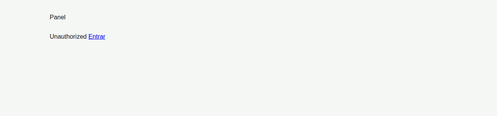

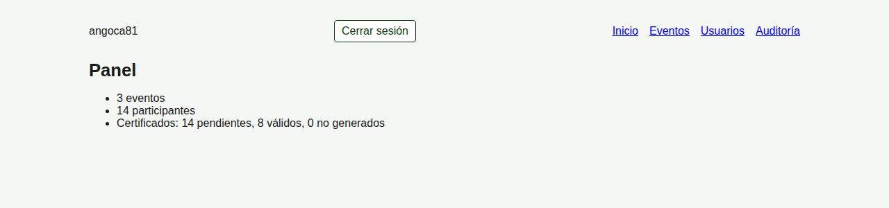

Arriba están el menú (**Inicio**, **Eventos**, **Usuarios**, **Auditoría**) y el botón **Cerrar sesión**. Cierra la sesión si usas un computador compartido.

## 3. Crear el evento

1. Ve a **Eventos**. Abajo está el formulario **Nuevo evento**.
2. Escribe el **Nombre** tal como debe salir en el certificado. Revisa tildes y mayúsculas: el nombre del evento se imprime en cada certificado.
3. Escribe la **Fecha de inicio**.
4. Marca los **Roles admitidos**: asistente, ponente, tallerista, voluntario u organizador. Solo podrás cargar personas con esos roles.
5. Deja sin marcar **Solo certificados ya generados**, salvo que vayas a subir PDF hechos por fuera (ver la sección 8).
6. Haz clic en **Crear evento**.

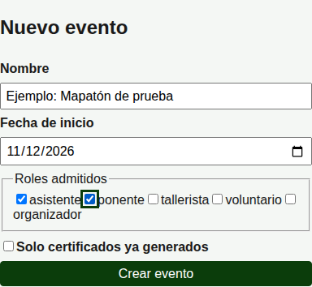

El evento queda en **Borrador**: nadie lo ve en la búsqueda pública. Arriba aparecen los botones **Publicar** y **Retirar evento**, y el aviso «Para activarlo hace falta una plantilla predeterminada».

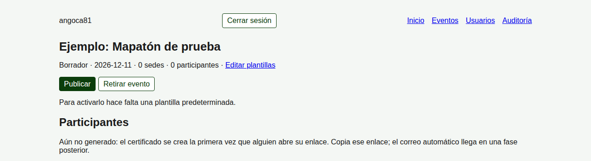

> **Un proyecto también es un «evento».** Para certificar la participación en un proyecto (por ejemplo, una tarea de mapeo remota), créalo como evento con la fecha de inicio. Si las fechas del proyecto deben salir en el certificado, escríbelas en el fondo (ver la sección 4).

## 4. La plantilla: fondo y campos

Haz clic en **Editar plantillas**. La primera vez se crea la plantilla **General**, que sirve para todos los roles.

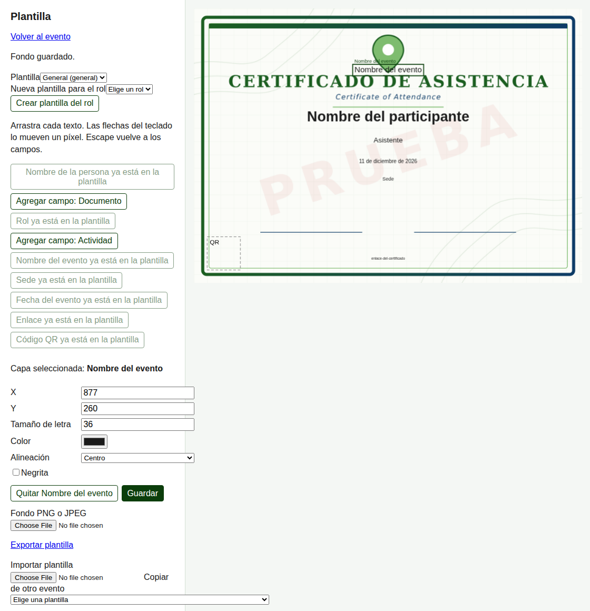

### 4.1. El fondo
- Es una imagen **PNG o JPEG** de **1754 × 1240 píxeles** (hoja A4 horizontal a 150 puntos por pulgada).
- Lleva todo lo que es **igual para todas las personas**: logos, título («Certificado de asistencia»), textos fijos, fechas, firmas, el pie de página.
- **No** lleva lo que cambia de persona a persona: el nombre, el documento, el QR. Eso lo pone la plataforma.
- Súbelo en **Fondo PNG o JPEG**. Si el archivo no sirve (otro formato, demasiado grande), la plataforma lo dice.

### 4.2. Los campos
Son los textos que cambian en cada certificado. Los botones de la izquierda los agregan; si un campo ya está, el botón lo dice («… ya está en la plantilla»).

| Campo | Qué imprime |
|---|---|
| Nombre de la persona | El nombre completo |
| Documento | Tipo y número, por ejemplo «CC 1000000103» |
| Rol | Asistente, Ponente, etc. |
| Actividad | El título de la charla o el taller (para ponentes y talleristas) |
| Nombre del evento | El nombre del evento |
| Sede | La sede, si el evento tiene varias |
| Fecha del evento | La fecha de inicio |
| Código | Solo el identificador del certificado (por ejemplo, «FVp7_6C2-zO7») |
| Enlace completo | La dirección entera, por ejemplo `https://certificados.osm.lat/c/FVp7_6C2-zO7` |
| Código QR | Un QR que abre la página del certificado |

**Para ubicar un campo:** haz clic en él sobre el lienzo y arrástralo, o escribe **X** y **Y** en el panel. Las flechas del teclado lo mueven un píxel. En el mismo panel cambias el **tamaño de letra**, el **color**, la **alineación** y la **negrita**. Para el QR, el **tamaño**.

**Guarda** cuando termines. Para quitar un campo que no necesitas, selecciónalo y usa **Quitar …**.

> **Consejos:**
> - Si el fondo ya dice el rol, el nombre del evento o la fecha, quita esos campos para que no salgan repetidos.
> - **Código** imprime solo el identificador. **Enlace completo** imprime la dirección entera. Si el fondo ya dice `certificados.osm.lat/c/`, usa el código y no el enlace completo, para que no salga repetido.
> - Deja el QR al menos a 60 píxeles del borde, sobre una zona clara del fondo.

La captura de arriba se hizo cuando el identificador se llamaba «Enlace». En la plataforma ese botón ahora dice «Código», y hay otro, «Enlace completo».

### 4.3. Una plantilla distinta para un rol
Si los ponentes llevan otro diseño, elige el rol en **Nueva plantilla para el rol** y haz clic en **Crear plantilla del rol**. Después cambias entre plantillas con el selector **Plantilla**. Los roles sin plantilla propia usan la General.

### 4.4. Reusar un diseño
- **Exportar plantilla** descarga un ZIP con el diseño y el fondo.
- **Importar plantilla** sube ese ZIP (o solo el diseño en `.json`) a otro evento. Antes de guardar muestra una vista previa: **Confirmar** o **Cancelar**.
- **Copiar de otro evento** hace lo mismo sin descargar nada: eliges la plantilla de otro evento de la lista.

## 5. Cargar a los participantes

### 5.1. Qué datos hacen falta
- **Nombre completo**, tal como debe salir en el certificado.
- **Correo o documento**: hace falta **al menos uno** de los dos. El documento son tres datos: país, tipo y número.
  - Sin correo ni documento, la persona no se puede cargar.
  - Un mismo correo no puede repetirse en personas distintas: quien lo busque vería los certificados de todas. **Nunca uses un correo de relleno** (como `a@b.co`) para varias personas: deja el correo vacío y usa el documento.
  - El mismo correo o el mismo documento, en este archivo o en uno ya guardado, son la misma persona. «Ana Pérez» y «ana perez» cuentan como el mismo nombre. Si el nombre no coincide, la fila se rechaza y el nombre guardado no cambia. Si faltaba el correo o el documento y el nombre coincide, se completa.
- **Rol**: uno de los roles admitidos del evento. Si una persona tiene dos roles (por ejemplo, ponente y asistente), recibe un certificado por cada rol.
- **Actividad**: solo si aplica, el título de la charla o el taller.

### 5.2. Uno por uno (Alta individual)
Llena el formulario **Alta individual** y haz clic en **Agregar participante**. El número de documento se puede escribir con o sin puntos: la plataforma los quita.

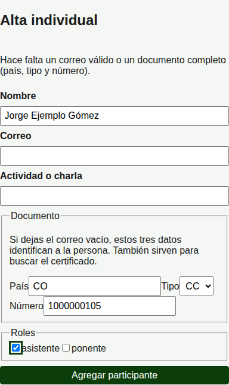

### 5.3. Varios a la vez (Importar CSV)
1. Haz clic en **Descargar la plantilla**: es un CSV de ejemplo con las columnas correctas, separadas por punto y coma:
   `full_name;email;country_code;doc_type;doc_number;role;activity_title;venue_code`
2. Llénalo en una hoja de cálculo y guárdalo como **CSV UTF-8** (para no perder las tildes). Ejemplo:

   ```
   full_name;email;country_code;doc_type;doc_number;role;activity_title;venue_code
   Ana Ejemplo Pérez;ana.ejemplo@example.org;CO;CC;1000000101;asistente;;
   Luis Ejemplo Rojas;;CO;CC;1000000102;asistente;;
   Marta Ejemplo Díaz;marta.ejemplo@example.org;CO;CC;1000000103;ponente;Mapear andenes con StreetComplete;
   Marta Ejemplo Díaz;marta.ejemplo@example.org;CO;CC;1000000103;asistente;;
   ```

   - `country_code`: país en dos letras (CO, MX, PE…).
   - `doc_type`: CC, CE o TI en Colombia.
   - `role`: en minúsculas, igual que en el evento.
   - `venue_code`: solo si el evento tiene sedes (ver la sección 7).
3. En **Importar CSV**, elige el archivo y haz clic en **Importar participantes**.

**Es todo o nada.** Si una sola fila tiene un error, **no se guarda ninguna** y la plataforma dice qué fila y qué campo corregir:

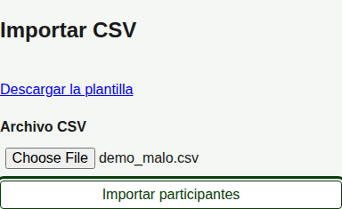

Corrige el archivo y vuelve a importarlo. Cuando todo está bien:

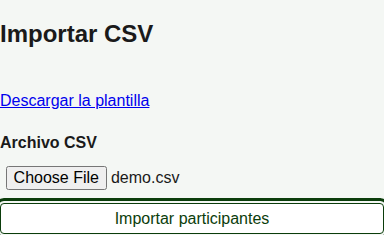

Puedes importar varias veces en el mismo evento: cada importación **agrega** personas.

### 5.4. La lista de participantes
Bajo **Participantes** aparece cada persona con su correo o su documento, y por cada rol:
- el **estado** del certificado: «Aún no generado» o «Válido»;
- su **enlace** (`/c/…`);
- el botón **Revocar**.

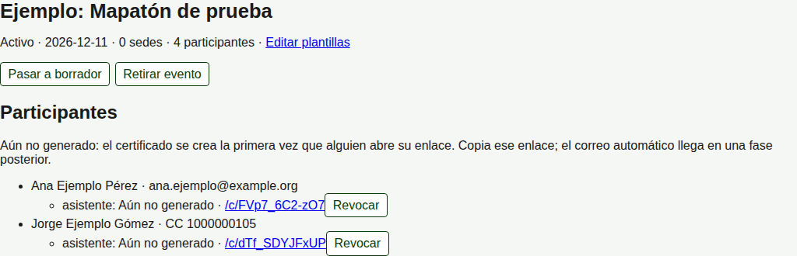

«Aún no generado» es normal: el certificado se crea la primera vez que alguien abre su enlace.

## 6. Publicar y compartir

1. Revisa los nombres en la lista (tildes, mayúsculas, nombres completos).
2. Haz clic en **Publicar**. El evento pasa a **Activo** y sus certificados aparecen en la búsqueda pública.
3. Comparte con cada persona **su enlace** (`https://certificados.osm.lat/c/…`). Cópialo de la lista de participantes. Por ahora la plataforma no envía correos: el envío automático llega en una fase posterior.
4. También puedes decirles que busquen su certificado en la página de inicio, con su correo o su documento.

**Pasar a borrador** quita el evento de la búsqueda pública, pero los enlaces ya compartidos siguen funcionando.

### Qué ve la persona
En la página de inicio busca con su correo, o con país, tipo y número de documento. El pie también tiene **Ayuda**:

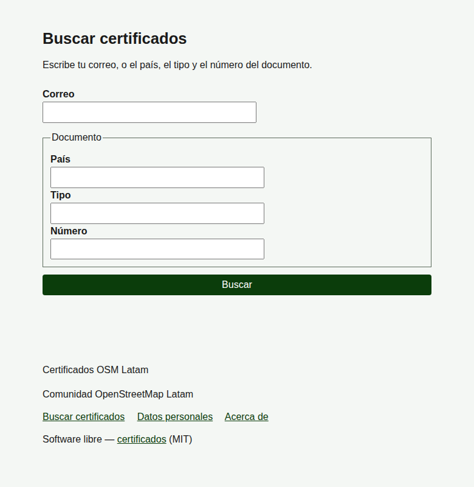

La captura del inicio se hizo antes de agregar **Ayuda** al pie.

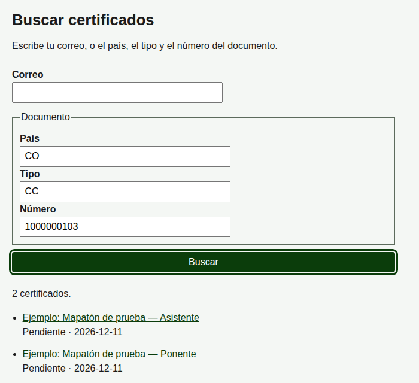

Y en la página de su certificado ve los datos, el documento enmascarado, la **suma de comprobación** (una huella del archivo PDF) y el botón **Descargar certificado**:

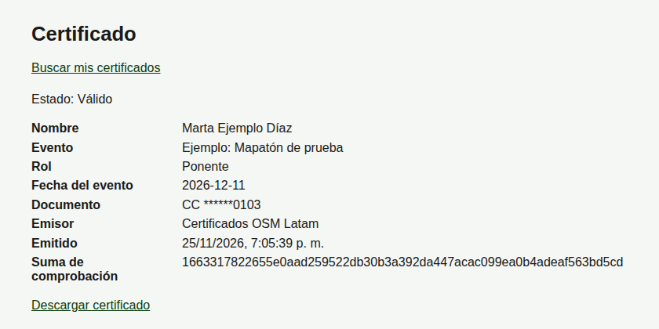

**Cómo se comprueba que un certificado es auténtico:** abriendo su enlace en este sitio (mira que la dirección sea la de la plataforma) o escaneando el QR. La firma impresa en el PDF es una imagen, no una firma digital: lo que da validez es la página del certificado en este sitio y su suma de comprobación.

## 7. Sedes (opcional)
Si un evento ocurre en varias ciudades o lugares, crea cada sede en **Agregar sede** (nombre y código, por ejemplo «Bogotá - UNAL» y «BOG»). En el CSV, la columna `venue_code` lleva el código. La sede es solo un texto que se imprime en el certificado; no identifica a la persona.

## 8. Certificados ya generados (PDF hechos por fuera)
Sirve cuando los certificados ya existen como PDF, por ejemplo si se imprimieron para entregarlos el día del evento.
1. Al crear el evento, marca **Solo certificados ya generados**.
2. En **Certificados ya generados**, descarga la plantilla de la hoja. Es un CSV con la columna `filename` (el nombre del PDF de cada persona) y los datos de la persona:

   ```
   filename;full_name;email;country_code;doc_type;doc_number;role
   cert-ana-asistente.pdf;Ana Ejemplo Pérez;ana.ejemplo@example.org;CO;CC;1000000101;asistente
   ```
3. Sube la **Hoja CSV** y un **ZIP** con los PDF, y haz clic en **Importar lote**.

Cada fila de la hoja necesita su PDF en el ZIP, y cada PDF del ZIP necesita su fila. Si falta o sobra uno, no se importa nada y la plataforma dice cuál. La plataforma guarda el PDF tal cual: lo que descarga la persona es idéntico al que subiste.

## 9. Corregir o revocar un certificado
Los datos de un participante no se editan desde el panel, y un certificado emitido nunca cambia. Para corregir un nombre o un documento: **revoca** el certificado y **carga de nuevo** a la persona con los datos correctos. Por eso conviene revisar bien la lista **antes de publicar**.

**Para revocar:** haz clic en **Revocar** junto al certificado. Se abre un aviso. Escribe el motivo si quieres (queda en la auditoría, no se publica) y confirma con **Revocar certificado**. El campo se llama **Motivo (opcional)**. El aviso dice que la acción no se puede deshacer, que el certificado dejará de descargarse y que su página dirá que fue revocado.

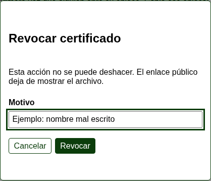

La captura muestra «Motivo» y el botón «Revocar». Esos textos ahora son «Motivo (opcional)» y «Revocar certificado».

La revocación **no se puede deshacer**. La página del certificado pasa a decir «Revocado» y el PDF ya no se puede descargar:

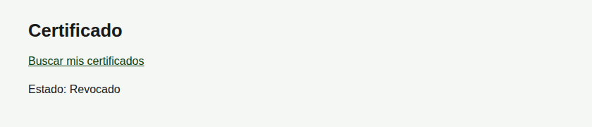

## 10. Retirar un evento
**Retirar evento** lo quita de la lista de eventos y de la búsqueda. Los enlaces ya compartidos siguen abriendo. Úsalo para eventos de prueba o que ya no deben aparecer. No es lo mismo que revocar: retirar oculta el evento; revocar invalida un certificado.

Si se retiró un evento por error, solo quien administra el servidor puede recuperarlo.

## 11. Datos personales
- La plataforma guarda el nombre, el correo, el documento y el rol de cada persona, que le entrega el organizador. Lo que hace con esos datos está en la página **Datos personales** (`/privacy`).
- La página pública del certificado **no muestra el correo** y muestra el documento enmascarado (por ejemplo, «CC ******0103»).
- No hay un listado público de participantes: para encontrar un certificado hay que conocer el correo o el documento de su titular.
- Si alguien pide corregir o borrar sus datos, debe escribir al correo de contacto que aparece en `/privacy`. Un administrador lo atiende.
- No subas a la plataforma más datos de los necesarios, y no compartas los archivos de participantes por chat.

## 12. Para administradores
- **Usuarios:** lista quién ha entrado y su rol. Desde allí se da o se quita el rol de editor o de administrador. Siempre debe quedar al menos un administrador.
- **Auditoría:** registro de quién hizo qué (cambios de roles, importaciones, revocaciones, etc.), con la hora de Bogotá y filtros. Solo la ven los administradores.

## 13. Problemas frecuentes

| Problema | Qué hacer |
|---|---|
| «No hay plantilla para el rol …. El evento generado no puede reservar ese certificado.» al importar | Abre **Editar plantillas** una vez (se crea la General) o crea la plantilla de ese rol. |
| «El correo no es válido.» | Revisa el correo de esa fila, o déjalo vacío si la fila trae el documento. |
| «Falta el correo o el documento: se necesita al menos uno» | La fila no tiene ninguno de los dos: agrega al menos uno. |
| «El correo … aparece en N personas distintas; quien lo busque verá todos sus certificados» | Hay un correo repetido o de relleno. Usa el correo real de cada persona, o déjalo vacío y usa el documento. |
| «Fila N: ya existe una persona con este documento (o correo) llamada "…" ; aquí viene como "…". Corrige el nombre para que coincida, o corrige primero a la persona existente.» | El correo o el documento ya están guardados con otro nombre. Iguala el nombre del archivo al que ya está, o corrige primero a la persona existente. La importación no cambia el nombre. En el alta individual sale la misma frase, sin «Fila N». |
| «Fila N: el correo pertenece a "…" y el documento a "…". Revisa los datos.» | El correo es de una persona y el documento de otra. Corrige cuál dato corresponde a quién. |
| Salen signos raros en vez de tildes | Guarda el CSV como **CSV UTF-8**. |
| No puedo publicar | Falta la plantilla predeterminada: abre **Editar plantillas**. |
| Una persona no encuentra su certificado | Verifica que el evento esté **publicado** y que busque con el mismo correo o documento que se cargó. |
| Un nombre salió mal en un certificado ya generado | Revoca ese certificado y carga a la persona de nuevo con el nombre correcto. |
